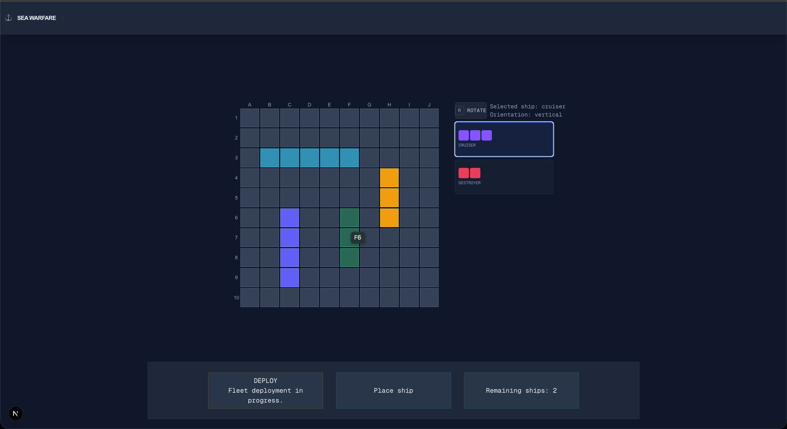
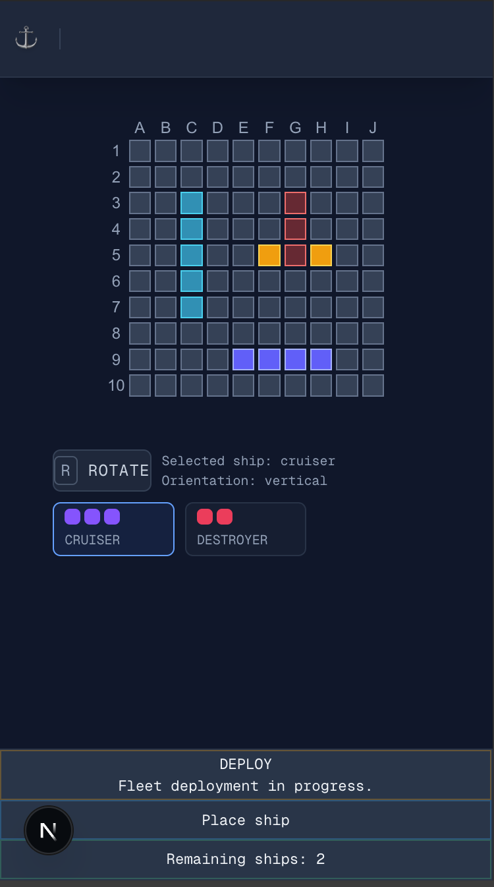

# Sea Warfare

A tactical naval strategy game inspired by the classic Battleship experience. Built with Next.js, React, and TypeScript, with a focus on maintainable architecture, responsive design, and interactive gameplay.

## Overview

Sea Warfare is a personal Front-End project focused on building a structured, maintainable, and responsive gameplay experience.

The project emphasizes software architecture, separation of concerns, predictable state management, and declarative UI composition.

Rather than focusing exclusively on gameplay features, Sea Warfare explores how to organize a React application around clear domain boundaries, application-level orchestration, and presentation responsibilities.

## Screenshots

### Fleet Placement


### Mobile Experience


## Features

- **Fleet Placement:** Configure, position, and reposition ships on the player's board before battle.
- **Interactive Game Boards:** Interact with board cells to select ship positions and perform placement actions.
- **Placement Preview:** Visualize proposed ship positions and receive feedback about their validity.
- **Responsive Interface:** Adapt the layout to desktop, tablet, and mobile screen sizes.
- **Adaptive Interactions:** Support hover-based and touch-based interactions while preserving consistent gameplay behavior.


## Tech Stack

| Technology | Purpose |
|---|---|
| Next.js 15 | Application framework |1
| React 19 | UI library |
| TypeScript | Static typing |
| Zustand | State management |
| Tailwind CSS | Styling and responsive layouts |
| Jest | Testing |
| clsx | Conditional class composition |
| tailwind-merge | Tailwind class conflict resolution |

## Architecture

Sea Warfare follows a layered architecture that separates gameplay rules, application coordination, and UI responsibilities.

**Domain**

Contains the core gameplay models, rules, and operations. It remains independent of React and UI-specific concerns.

**Application**

Coordinates gameplay workflows, manages application state, and derives semantic information required by the interface.

**Presentation**

Composes the UI through declarative React components. It consumes application contracts and presentation-oriented data without owning gameplay rules or authoritative state.

### Architectural Principles

- Separation of concerns and explicit ownership boundaries.
- Domain-driven gameplay rules and mutations.
- Derivation-first application logic.
- Lightweight application orchestration.
- Declarative and responsive UI composition.
- Separation between authoritative gameplay state and temporary interaction state.

## Project Structure

The codebase is organized around architectural responsibilities, separating domain logic, application orchestration, and UI composition.

```text
sea-warfare/
├── public/                  # Static assets
├── src/
│   ├── app/                 # Next.js App Router entry points
│   ├── application/         # Application logic and orchestration
│   │   ├── board/           # Board ViewModel and presentation derivations
│   │   ├── game-flow/       # Game flow coordination and derivations
│   │   └── placement/       # Placement controller, interactions and derivations
│   ├── components/          # React UI components
│   │   ├── board/
│   │   ├── game/
│   │   └── ui/
│   ├── lib/
│   │   ├── device/          # Device and input capability utilities
│   │   ├── domain/          # Game models, rules and domain mutations
│   │   ├── store/           # Zustand gameplay store
│   │   └── utils/           # Shared utilities
│   └── styles/              # Global design tokens
├── package.json
└── tsconfig.json
```

## Getting Started

### Prerequisites

- Node.js
- npm

### Installation

Clone the repository:

```bash
git clone https://github.com/BetoCarr/sea-warfare.git
```

Navigate to the project directory:

```bash
cd sea-warfare
```

Install dependencies:

```bash
npm install
```

Start the development server:

```bash
npm run dev
```

Open [http://localhost:3000](http://localhost:3000) in your browser.

## Testing

The project uses Jest for unit and integration testing.

Run the test suite:

```bash
npm test
```

Refer to the project's package scripts for additional testing commands.

## Contributing

Contributions are welcome! If you'd like to improve Sea Warfare, feel free to fork the repository and submit a Pull Request.

Please read [CONTRIBUTING.md](CONTRIBUTING.md) for contribution guidelines.

## License

This project is licensed under the MIT License.
See the [LICENSE](LICENSE) file for details.

## Project Status

Sea Warfare is an ongoing personal project focused on Front-End engineering, software architecture, and maintainable React applications.

### Current Development Stage: Fleet Placement

The current implementation focuses on the fleet placement phase, including:

- Interactive ship placement and repositioning.
- Placement validation and visual previews.
- Responsive layouts and adaptive input interactions.
- Game flow coordination and application state management.

### Planned Development

- Battle phase and combat mechanics.
- AI opponent and gameplay logic.
- Game completion and final results.

The project is actively evolving, with an emphasis on maintainable architecture, clear separation of responsibilities, and reliable application behavior.